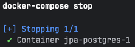
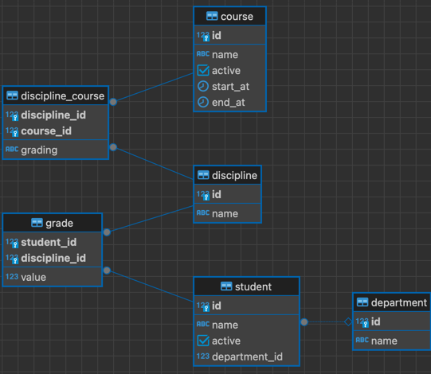

# University Model — Hibernate

The goal of this task is to practice some major Hibernate concepts on a Postgres database.

## Description

In this module, you will reimplement your JPA practical task solution using Hibernate and
try out some Hibernate features.
So, the goal so far is to design database schema and JPA classes to operate with a university model that will include
students, courses, disciplines, and grading using Hibernate classes.

The task is split into sections. It's recommended that you complete this task iteratively, section by section;
however, this is not required. You can do it all at once if you prefer.

The instructions below refer to both "sections" and "tasks".
Keep in mind that in this context, these are referring to the same thing.

You must use a Postgres database.

### How to Start a Database

First, you need to install Docker and Docker Compose on your local machine.
This will allow you to run a database instance in an isolated environment.

The easiest way is to install Docker Desktop.
Follow one of the guides below, depending on which OS you use:
* Windows - https://docs.docker.com/desktop/setup/install/windows-install/
* Linux - https://docs.docker.com/desktop/setup/install/linux/
* Mac - https://docs.docker.com/desktop/setup/install/mac-install/

After you install Docker, launch Docker Desktop to make sure it is up and running.

Go to the project directory using a command shell (cmd, bash, zsh, etc.) and execute the following command:

```bash
docker-compose start
```

If everything is successful, you'll see the following message:



Now, you can connect to the database using the configuration below:
* port - 55432
* database - mydatabase
* user - myuser
* password - secret

### SQL scripts

You must provide SQL script(s) that describe your schema. Use the `Flyway` approach to do this.
* You must put your SQL scripts in the `src/main/resources/db/migration` directory.
* Each script must have a `.sql` extension.
* Each script should start with `Vddd__` , where `d` is a digit.

To clarify the last point, if you have multiple scripts, they must be in the correct order.
The `Vddd` prefix determines this order. So, if you have three scripts, they should be named as follows:
1. `V001__init.sql`
2. `V002__adding_somethig.sql`
3. `V003__changing_something.sql`

`Flyway` supports different ordering formats, but you should stick to the simplest one.

If you have only one script, name it `V001__init.sql`.

However, it's recommended to write multiple scripts to practice making gradual changes to a database.
If you feel this is too hard, it's okay to provide just one script for all the changes.

### Java classes

#### JPA

Your work will mostly involve defining JPA entities mapped on your schema.
So, there will be entities and repositories that encapsulate work with database- and Hibernate-specific classes,
such as `Session` or `SessionFactory`.
All JPA-related classes must go under `edu.epam.fop.web.jpa` packages.

#### Services

However, in some cases, it's wise to implement functionality on the service layer
instead of writing complex SQL queries. As long as the requirements are met,
you can decide which approach to use. Feel free to ask your classmates or professors how best to do this.
All services must go under the `edu.epam.fop.web.service` package.

#### Demos

You'll also need to provide demonstration classes (demo-classes).
They will have at least a `main` method, which demonstrates how your code works.
For each section, you'll need to provide at least one demo-class,
but there will be more than that in most cases.
All demo classes must go under `edu.epam.fop.web.demos.*` packages.
The first section should go in the `task1` sub-package, the second in `task2`, etc.

If a task says that a demo-class accepts some parameters, they will be passed as program arguments.
You can get them via an args parameter of a main method. For example, if a task says DemoClass accepts name and id,
this class might look like the following:

```java
public class DemoClass {

    public static void main(String[] args) { 
        String name = args[0]; 
        long id = Long.parseLong(args[1]); 

        doWork(name, id); 
    } 

    // there is implementation of doWork 
}
```

## Requirements

### Task 0

The following task contains the same infrastructure that was used for the JPA task.

```
Feel free to reuse your existing solution from the JPA task.
```

According to the schema:



Create the following tables:
1. `student`
   1. id - bigserial primary key
   2. name - varchar
   3. active - boolean
   4. department_id - bigint
2. `course`
   1. id - bigserial primary key
   2. name - varchar
   3. active - boolean
   4. start_at - timestampz
   5. end_at - timestampz
3. `department`
   1. id - bigserial primary key
   2. name - varchar
4. `discipline`
   1. id - bigserial primary key
   2. name - varchar
5. `discipline_course`
   1. discipline_id - bigint not null
   2. course_id - bigint not null
   3. grading - varchar
6. `grade`
   1. student_id - bigint not null references `student(id)`
   2. discipline_id - bigint not null references `discipline(id)`
   3. value - int null. Allowed values: from 0 to 100 inclusive

For `discipline_course`, set the primary key as `primary key(discipline_id, course_id)`.
For `grade`, set the primary key as `primary key(student_id, discipline_id)`.

Use proper naming and store all SQL scripts in `resources\db.migration`.

Set up all entities in `edu.epam.fop.web.jpa.entity` according to the database schema (bind entities to database tables).
Feel free to reuse your solution from the JPA practical task.

Create a `resources\hibernate.cfg.xml` file with the proper settings.

### Task 1

Now that you have set up the infrastructure, it's time to practice using `SessionFactory` and `Session`.
Implement CRUD operations for the entities in the repository classes.
This means that by using the `StudentRepository` class, it's possible to:

* `C`reate a new student in a database
* `R`ead student(s) from a database
* `U`pdate a student in a database
* `D`elete a student from a database

By default, both students and courses must be inactive.
So, for example, if you create a new student, it must have `active = false`.

To demonstrate how your code works, you must implement the following demo classes:

* `CreateCourseDemo` - accepts the name of a course and creates a new course with this name
* `CreateStudentDemo` - accepts the name of a student and creates a new student with this name
* `FindStudentDemo` - accepts a student id and prints it to the console
* `FindCourseDemo` - accepts a course id and prints it to the console
* `ActivateStudentDemo` - accepts a student id and updates its `active` to `true`
* `ActivateCourseDemo` - accepts a course id and updates its `active` to `false`
* `DeleteStudentDemo` - accepts a student id and deletes it
* `DeleteCourseDemo` - accepts a course id and deletes it

You can find these classes under the `edu.epam.fop.web.demos.task1` package.

### Task 2

Continue leveraging `SessionFactory` and `Session`.
For `department`, you must implement a method for creating it. For simplicity's sake, you will treat it as immutable,
so no updating or deleting is required.

You need to add methods for:
* Searching for students by department
* Moving a student to a department

By default, a student is created without a department.

Implement demo-classes under the `edu.epam.fop.web.demos.task2` package:
* `CreateDepartmentDemo` - accepts the name of a department and creates a new department with this name
* `MoveStudentToDepartmentDemo` - accepts a student id and department and updates this student `department_id` column to the passed department id
* `SearchStudentsByDepartmentDemo` - accepts a department id and prints all the students tied to this department to the console

### Task 3

Add methods for updating `start_at` and  `end_at` columns for a course. By default, they are `null`.

Here are the business requirements:

* If a course does not have `start_at`, it's in draft status, so no validation is required.
* If `end_at` is null, it's an infinite course with no deadline.
* If a course has both `start_at` and `end_at`, you must implement a validation to verify that `end_at` comes after `start_at`.

This means that the course field `active` can be ignored and that `start_at` and `end_at` can be used to determine
if a course is ongoing or not. A course is considered active if it has a non-null `start_at` in the past and `end_at`
is `null` or in the future. If a course's `start_at` is in the future, this course is considered a future course.

Add methods for searching:
* Active courses
* Future courses

And leverage `SessionFactory` and `Session` during implementation.

Implement demo-classes for task 3:
* `UpdateCourseStartAtDemo` - accepts a course id and a new start_at value and updates it in the database
* `UpdateCourseEndAtDemo` - accepts a course id and a new start_at value and updates it in the database
* `SearchActiveCoursesDemo` - prints all active courses to the console
* `SearchFutureCoursesDemo` - prints all future courses to the console

### Task 4

Add methods for:
* Creating a discipline
* Deleting a discipline
* Creating a relation between a course and a discipline
* Deleting a relation between a course and a discipline

Keep in mind that if you delete disciplines, the courses tied to them must not be deleted, and vice versa.

Implement demo-classes in the `edu.epam.fop.web.demos.task4` package:
* `CreateDisciplineDemo` - accepts a name and creates a new discipline
* `DeleteDisciplineDemo` - accepts an id and deletes a discipline
* `LinkCourseDisciplineDemo` - accepts course and discipline ids and creates a relation between them
* `UnlinkCourseDisciplineDemo` - accepts course and discipline ids and deletes a relation between them
* `SearchDisciplinesForCourseDemo` - accepts a course id and prints all the disciplines tied to this course
* `SearchCoursesOfDisciplineDemo` - accepts a discipline id and prints all courses tied to this discipline

Use `SessionFactory` and `Session` in implementation.

### Task 5

Use `SessionFactory` and `Session` to implement methods for:
* Updating the grading type for the course–discipline relation
* Searching disciplines by course and grading type

Implement demo-classes in the `edu.epam.fop.web.demos.task5` package:
* `UpdatingDisciplineCourseRelationDemo` - accepts a course and discipline id and grading type. It must update the existing relation between course–discipline and grading
* `SearchDisciplineByCourseAndGradingDemo` - accepts a course id and grading format and prints to the console all disciplines that are tied to the course and have the passed grading

### Task 6

Continue leveraging `SessionFactory` and `Session`.
Add methods for:
* Adding a relation between student and discipline and grading
* Updating this relation
* Deleting this relation

Create a JPA entity for `Grade`. In the `value` field, add `@Min` and `@Max` annotations.

Update `student` with an `@OneToMany` field for `grade`. Add an `@Transient` field for average grade.
This must be updated in the `grades` setter.

Keep in mind that a student's average grade must be calculated only in Java code and not persisted in the database in any way.

Implement demo-classes in the `edu.epam.fop.web.demos.task6` package:
* `AddingOrUpdatingGradeDemo` – accepts a student id, discipline id, and int value for grading and updates or creates a relation between discipline and student
* `DeletingGradeDemo` - accepts a student id and discipline id and deletes the relation between them

### Task 7 — Entity Lifecycle

Create a Course object and implement a demonstration of transient, persistent, detached, and removed states
in the following classes:
- `edu.epam.fop.web.demos.task7.DetachedAndPersistentStatesDemo.java`
- `edu.epam.fop.web.demos.task7.DetachedThenPersistentThenRemovedAndDetachedStatesDemo.java`
- `edu.epam.fop.web.demos.task7.TransientAndPersistentStatesDemo.java`

Add comments describing the example.

You may need/use the following:
* `session.beginTransaction()`
* `session.persist(course)`
* `session.contains(course)`
* `session.refresh(course)`
* `session.remove(course)`
* `session.get(Course.class, course.getId())`

### Task 8 — Caching

Set up and enable a second-level cache:
1. Add elements to `hibernate.cfg.xml` to enable it:
```xml
...
<property name="hibernate.cache.use_second_level_cache">true</property>
<property name="hibernate.cache.region.factory_class">org.hibernate.cache.jcache.internal.JCacheRegionFactory</property>
<property name="hibernate.javax.cache.uri">ehcache.xml</property>
<property name="hibernate.javax.cache.provider">org.ehcache.jsr107.EhcacheCachingProvider</property>
...
```
2) Create `resources\ehcache.xml` and set it up with the following:
```xml
<eh:config
        xmlns:xsi='http://www.w3.org/2001/XMLSchema-instance'
        xmlns:eh='http://www.ehcache.org/v3'
        xmlns:jsr107='http://www.ehcache.org/v3/jsr107'
        xsi:schemaLocation="
        http://www.ehcache.org/v3 http://www.ehcache.org/schema/ehcache-core-3.3.xsd
        http://www.ehcache.org/v3/jsr107 http://www.ehcache.org/schema/ehcache-107-ext-3.3.xsd">

    <eh:cache-template name="entities">
        <eh:resources>
            <eh:heap unit="entries">1000</eh:heap>
        </eh:resources>
    </eh:cache-template>

    <eh:cache alias="edu.epam.fop.web.jpa.entity.Course" uses-template="entities">
    </eh:cache>
</eh:config>
```
3) Make sure all the required dependencies are in `pom.xml`, including the following:
```xml
<dependency>
   <groupId>org.hibernate.orm</groupId>
   <artifactId>hibernate-jcache</artifactId>
   <version>6.5.2.Final</version>
</dependency>
<dependency>
   <groupId>org.ehcache</groupId>
   <artifactId>ehcache</artifactId>
   <version>3.10.8</version>
   <exclusions>
       <exclusion>
           <groupId>org.glassfish.jaxb</groupId>
           <artifactId>jaxb-runtime</artifactId>
       </exclusion>
   </exclusions>
   <classifier>jakarta</classifier>
</dependency>
```
4) Use class-level annotations for the entity to start caching it in the second-level cache:
```java
@jakarta.persistence.Cacheable
@org.hibernate.annotations.Cache(usage = CacheConcurrencyStrategy.READ_WRITE)
```
5) In the class `edu.epam.fop.web.demos.task8.CacheDemo`, make sure the second-level cache is working properly. You may need/use the following:
- `session.clear()`
- `sessionFactory.getCache().evictAllRegions()`
- `sessionFactory.getStatistics()`
- `stats.getSecondLevelCacheHitCount()`
- `stats.getSecondLevelCacheMissCount()`
- `stats.getSecondLevelCachePutCount()`
6) Add comments describing the example.
